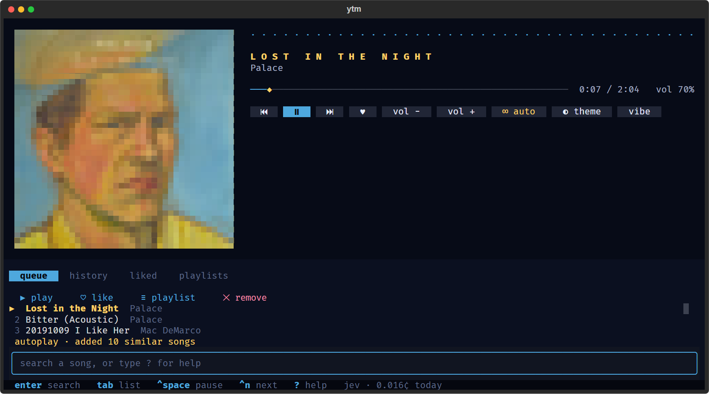
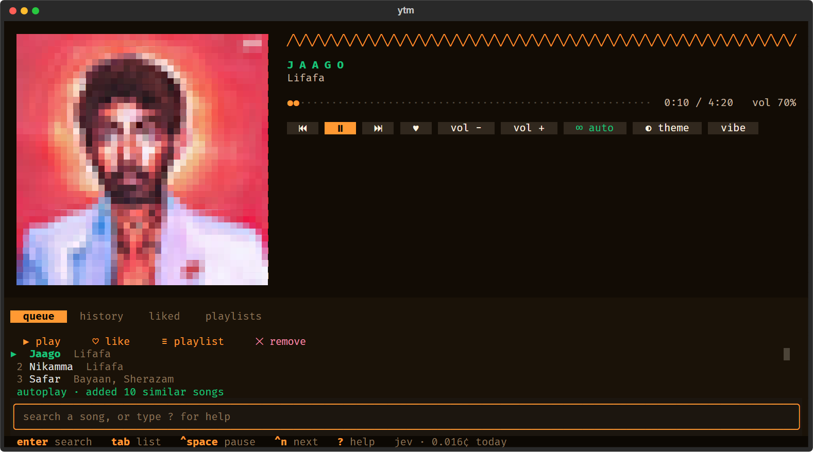
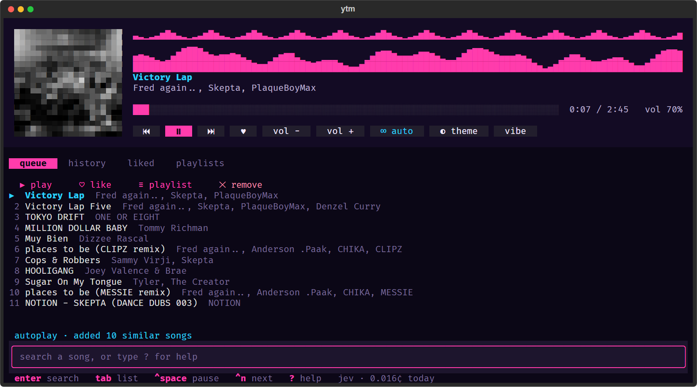
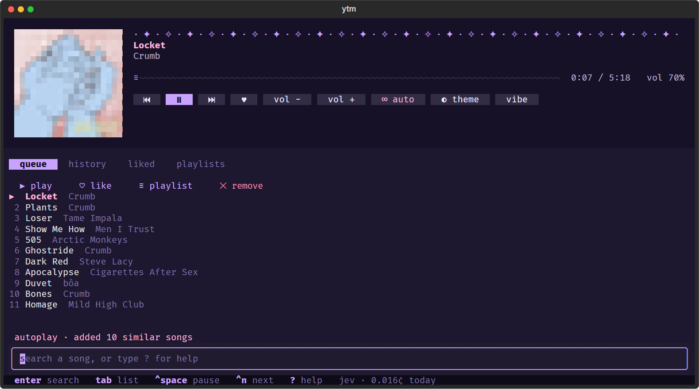
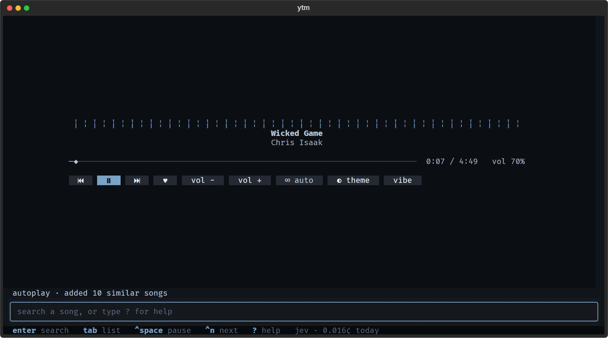
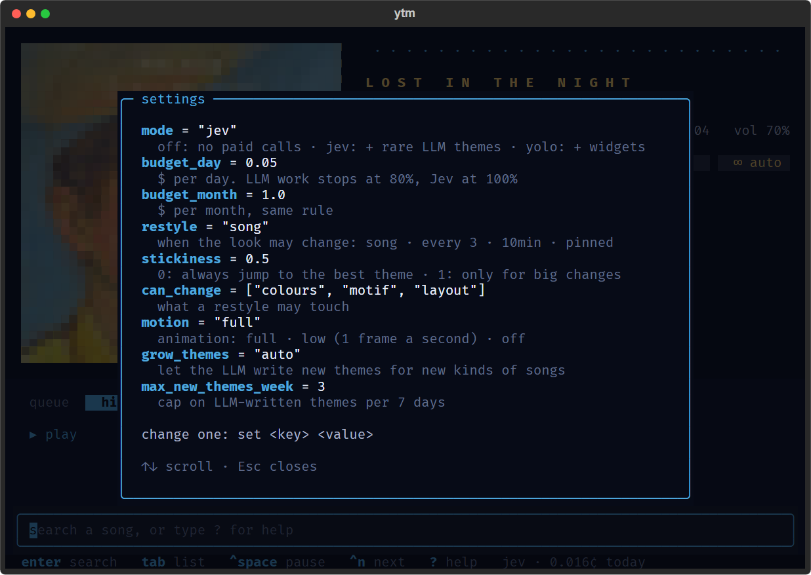

# ytm

[](https://github.com/debsagar/ytm-cli/actions/workflows/ci.yml?query=branch%3Adev)

A minimal-RAM YouTube Music player for the Windows terminal. Search, queue, start radio mixes, like songs, build playlists and replay your history from a small mini-player window: no browser, no login. The player restyles itself for each song.

Under the hood it is a single audio-only [mpv](https://mpv.io) process fed by [yt-dlp](https://github.com/yt-dlp/yt-dlp), controlled by a small [Textual](https://textual.textualize.io) app. Together they use about 120 MB of RAM.



## Requirements

- Windows 10 or 11 (Windows Terminal recommended)
- [uv](https://docs.astral.sh/uv/), which also fetches Python 3.12 if you don't have it
- mpv and yt-dlp (yt-dlp pulls in FFmpeg automatically)
- A JavaScript runtime for yt-dlp: [Deno](https://deno.com) (yt-dlp's default) or Node.js

## Install

Paste this into PowerShell:

```powershell
irm https://raw.githubusercontent.com/debsagar/ytm-cli/main/install.ps1 | iex
```

Then run `ytm`, in the same terminal or any new one. The script installs whatever is missing (mpv, yt-dlp, uv, git, and Deno if you have no Node.js) with winget, puts ytm in `%LOCALAPPDATA%\ytm`, sets up its Python packages and adds the `ytm` command. Running it again updates ytm, like `ytm update`.

To uninstall, delete `%LOCALAPPDATA%\ytm` (your library and history are in its `data` and `mpv` folders, so copy them first if you want to keep them) and `%LOCALAPPDATA%\Microsoft\WindowsApps\ytm.cmd`.

### Manual install

1. Install the dependencies:

   ```powershell
   winget install shinchiro.mpv
   winget install yt-dlp.yt-dlp
   powershell -ExecutionPolicy ByPass -c "irm https://astral.sh/uv/install.ps1 | iex"
   winget install DenoLand.Deno   # skip if you already have Node.js
   ```

2. Clone this repo somewhere permanent:

   ```powershell
   git clone https://github.com/debsagar/ytm-cli.git C:\Tools\ytm
   ```

3. Nothing to install by hand: the first `ytm` run uses uv to create a `.venv` folder next to the code with the exact package versions in `uv.lock` (Textual, ytmusicapi and Pillow for album art). Open a new terminal after installing uv so it is on your `PATH`.

4. Make `ytm` available from any terminal. Either add the clone folder to your `PATH`, or create a one-line forwarder in a folder that is already on it:

   ```powershell
   Set-Content "$env:LOCALAPPDATA\Microsoft\WindowsApps\ytm.cmd" '@"C:\Tools\ytm\ytm.cmd" %*'
   ```

   Use the forwarder if the clone path contains a `;`, since such a folder can't be put on `PATH` reliably.

5. Open a new terminal and run `ytm`.

ytm finds mpv in `C:\Program Files\MPV Player`, a `bin` folder inside the repo, or on `PATH`, and yt-dlp in the winget links folder, `bin`, or on `PATH`.

## The mini-player

`ytm` with no arguments opens the player in its own small Windows Terminal window (`ytm here` opens it in the current terminal).

- Type a song name and press Enter to search; pick a result with ↑/↓ and Enter.
- `play <song>`, `queue <song>`, `radio <song>`, `like`, `save <name>`, `auto`, `skip`, `prev`, `pause`, `vol 40`, `remove 3`, `clear`, `quit`
- Tab moves into the list: Enter plays, `a` adds to the queue, `l` likes, `s` adds to a playlist, `d` removes. ←/→ switch between the queue, history, liked, playlists and results tabs. Esc goes back to the prompt.
- Every button and tab is clickable: playback, ♥ like, volume, autoplay, and actions for the selected song.
- Ctrl+Space pause · Ctrl+N next · Ctrl+B previous · Ctrl+←/→ seek
- Ctrl+↑/↓ volume · Ctrl+L like · Ctrl+R autoplay · Ctrl+T themes · Ctrl+G layouts · F1 help. These work while you type.
- F2 (or Ctrl+P) pops into mini mode: one song line, a thin bar and the prompt, for a small corner window. F2 again brings everything back. A window too small for the player shows the mini line on its own.
- Type `?` for the full help.

### Themes and layouts

Each song gets a theme: colours, a scrolling motif, a progress-bar style and one of four layouts: **classic** (album art and the song list), **hero** (big art and a spaced-out title), **stage** (an animated equaliser next to the art) or **focus** (just the song, centred). There are 13 built-in themes, such as *neon rave*, *rainy window* and *pit wall*.

| hero | stage |
|---|---|
|  |  |
| **classic** | **focus** |
|  |  |

- **◐ theme** cycles through every theme.
- **▦** cycles the layouts; type `layout` to see them all and pick one, previewed as you move (Esc puts yours back).
- **vibe** switches between calm (focus layout, no decoration), normal and loud (stage layout).

Without the optional brain (below), songs keep the default look; both buttons still work.

### Importing playlists

```powershell
ytm import https://music.youtube.com/playlist?list=... [more urls] [--judge]
```

This copies public or unlisted YouTube Music playlists into your local playlists. `--judge` also measures every new song with the brain now, so themes are ready before you press play.

### The brain (optional)

- [TypeSafe](https://typesafe.ai) **Jev** measures each song once: energy, mood and a few context tags (club, soundtrack, motorsport, South Asian). The result is cached, and plain code picks the nearest theme.
- When 3 or more songs fit no theme but sit close to each other, an LLM (Claude Haiku via [OpenRouter](https://openrouter.ai)) designs a new theme for them, up to 24 themes in total.

To turn it on, create `%USERPROFILE%\.config\ytm\secrets.env` (outside the repo) with one line per key: `TYPESAFE_API_KEY=` followed by your TypeSafe key, and `OPENROUTER_API_KEY=` followed by your OpenRouter key. Environment variables with the same names also work. Jev needs only `TYPESAFE_API_KEY`; without `OPENROUTER_API_KEY`, no new themes are written. With no keys at all, the brain is off and everything else works as normal.

Every paid call is logged with its tokens and price. The footer shows what the brain has spent today, and `cost` shows today, this month and all time. Jev costs about $0.00003 per song; a new theme costs about $0.0004.

### Settings

Type `set` to see every setting and `set <key> <value>` to change one (`mode off` is a shortcut for `set mode off`). They are saved in `%USERPROFILE%\.config\ytm\settings.toml`, which you can also edit by hand while ytm runs.



| Setting | Default | What it does |
|---|---|---|
| `mode` | `jev` | `off`: no paid calls (songs measured before still get their theme). `jev`: measure new songs, and let the LLM write the occasional new theme. `yolo`: reserved for LLM-designed widgets |
| `budget_day`, `budget_month` | `0.05`, `1.0` | Dollar limits. LLM work pauses at 80% of either, Jev stops at 100% |
| `restyle` | `song` | When the look may change: `song`, `every 3` (songs), `10min`, or `pinned` |
| `stickiness` | `0.5` | 0 switches to the best theme every time; 1 only for big changes. On 84 test songs, 0.5 changed the look about every 3 songs and 1 about every 12 |
| `can_change` | colours, motif, layout | Which parts a restyle may change; e.g. `set can_change colours` keeps your layout fixed |
| `motion` | `full` | Animation: `full`, `low` (one frame a second) or `off` |
| `grow_themes`, `max_new_themes_week` | `auto`, `3` | Whether and how often the LLM may write new themes |
| `llm_model` | `anthropic/claude-haiku-5.5` | Any [OpenRouter](https://openrouter.ai/models) model id (`vendor/name`) that supports JSON output, used to write themes. Reasoning is switched off for the call; if the response has no cost, the logged price is estimated at Haiku rates and marked `estimated` |

### Updating

`ytm update` moves your copy to the latest release and installs any new Python packages. Your library and history are not touched: they live in the code folder's `data` and `mpv\history.tsv`, which git ignores, unless a `ytm.home` file or `YTM_HOME` points elsewhere. Your settings live in `%USERPROFILE%\.config\ytm`. If you've edited the code's own files, git refuses and nothing changes.

**Channels.** `stable` is the `main` branch, which the installer gives you. `dev` gets the latest features first and may have bugs. `ytm update dev` switches your copy to dev, `ytm update stable` switches it back (code and packages; your data and settings stay as they are). After that, a plain `ytm update` keeps following the channel you're on.

## Classic commands

The original one-shot commands still work and start mpv directly in the terminal.

| Command | What it does |
|---|---|
| `ytm <search terms>` | Play the top YouTube Music song result |
| `ytm radio <search terms>` | Play a mix (up to 100 tracks) seeded from the top result |
| `ytm search <search terms>` | List 10 songs; type a number to play it, or `r<number>` for radio from it |
| `ytm <url>` | Play a YouTube / YT Music track, album or playlist URL |
| `ytm history [count]` | List recently played tracks (default 20); pick one to replay, or `r<number>` for radio |
| `ytm stop` | Stop the player |
| `ytm help` | Show usage |

Any argument starting with `--` is passed straight to mpv:

```powershell
ytm --volume=40 radio daft punk
ytm --shuffle https://music.youtube.com/playlist?list=...
```

Include the artist in searches ("daft punk around the world"); search results only show song titles.

### Keys while playing

| Key | Action |
|---|---|
| `space` | Pause / resume |
| `q` | Quit (prefer this over Ctrl+C, which triggers cmd's "Terminate batch job?" prompt) |
| `n` / `>` | Next track |
| `p` / `<` | Previous track |
| `+` / `0` | Volume up |
| `-` / `9` | Volume down |
| `m` | Mute |
| `→` / `←` | Seek 5 s |
| `↑` / `↓` | Seek 1 min |
| `s` | Toggle shuffle |

## History

Every track that starts playing, including each song in a radio mix, is logged to `mpv\history.tsv` as time, URL and "Artist - Title". `ytm history` reads it back. Delete the file to clear your history; it is excluded from git.

Likes, playlists, song measurements, themes and play/skip/theme/vibe events are kept in `data\ytm.db` (SQLite), also excluded from git.

## How it works

The mini-player (`ytm/` package):

- `player.py` starts mpv hidden and controls it over its JSON IPC named pipe (one connection for commands, one for events).
- `search.py` searches YouTube Music and builds radio mixes with [ytmusicapi](https://github.com/sigma67/ytmusicapi).
- `library.py` reads play history and keeps likes, playlists, song features, themes and events in SQLite.
- `art.py` draws album art with half-block characters.
- `theme.py` holds the theme format, the 13 seed themes, layouts, motifs and the equaliser.
- `brain.py` asks Jev about songs, assigns themes by nearest cluster centre, and asks the LLM for new ones.
- `importer.py` implements `ytm import`.
- `app.py` is the Textual UI.

The classic commands:

- `ytm.cmd` runs `ytm.ps1`, which resolves your search or URL (via yt-dlp's YouTube Music search) and exits. `ytm.cmd` then starts mpv, so no PowerShell process stays in memory while music plays.
- `mpv\mpv.conf` holds the player settings: audio only, a 24 MiB cache, no window. It is loaded with `--config-dir`, so your own mpv config is not read or changed.
- `mpv\input.conf` adds the extra key bindings, and `mpv\scripts\history.lua` writes the history log.

## Limitations

- No account access: your YouTube Music likes and private playlists aren't available (likes and playlists here are local), and age-restricted tracks won't play.
- Radio is capped at 100 tracks; uncapped mixes are ~700 entries and take about 20 s to start.
- A pasted `watch?v=...&list=...` link plays only that one track; pure playlist and album URLs play in full.
- Expect a few seconds' delay before the first track starts while yt-dlp resolves the stream.

## Contributing

Pull requests are welcome; see [CONTRIBUTING.md](CONTRIBUTING.md).
